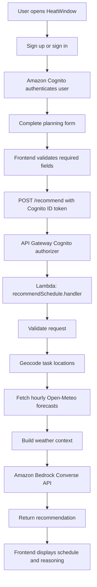

# HeatWindow ☀️

**Plan outdoor tasks around the weather—not the other way around.**

**Live application:** https://staging.div2ctk3ctmuy.amplifyapp.com

**Demo Video:** https://youtu.be/ifaVzw-1DMQ

HeatWindow is a weather-aware outdoor task scheduling assistant. Users enter the tasks they need to complete, their route locations, travel and activity durations, task flexibility, planning hours, and the person whose heat exposure should be considered. HeatWindow retrieves hourly weather information for the task locations and uses an Amazon Bedrock language model to recommend a practical schedule with explanations grounded in the available forecast.

> **Important:** HeatWindow is a planning aid, not a medical assessment, a guaranteed-safe schedule, a route planner, or an official heat-warning service. Check current local conditions before going outdoors.

---

## Table of contents

- [Problem statement](#problem-statement)
- [Solution](#solution)
- [Live demo](#live-demo)
- [Key features](#key-features)
- [How it works](#how-it-works)
- [Architecture](#architecture)
- [Technology stack and why it is used](#technology-stack-and-why-it-is-used)
- [Scheduling logic and important rules](#scheduling-logic-and-important-rules)
- [Weather data](#weather-data)
- [Frontend fields](#frontend-fields)
- [Backend request format](#backend-request-format)
- [Project structure](#project-structure)
- [Run locally](#run-locally)
- [AWS deployment](#aws-deployment)
- [Authentication and security](#authentication-and-security)
- [Error handling and troubleshooting](#error-handling-and-troubleshooting)
- [Current limitations](#current-limitations)
- [Future improvements](#future-improvements)
- [Use of ChatGPT and contribution acknowledgement](#use-of-chatgpt-and-contribution-acknowledgement)
- [References](#references)

---

## Problem statement

Everyday outdoor responsibilities—such as taking a child to school, buying medicines, grocery shopping, cycling to appointments, or completing errands—often have to fit into a limited period of time. The most convenient sequence of errands is not necessarily the most suitable one for the weather.

A useful plan needs to consider more than a weather application's temperature display. It must account for:

- **The actual tasks:** what needs to be done and where each activity takes place.
- **Route continuity:** where the person starts, where each journey ends, and where the next task begins.
- **Time constraints:** the planning window and which tasks are fixed or flexible.
- **Outdoor exposure:** user-provided travel duration, activity duration, travel mode, and physical intensity.
- **Personal vulnerability:** whether a task concerns an adult, child, elderly person, or patient.
- **Weather conditions over time:** temperature, apparent temperature, humidity, wind, UV index, and precipitation probability where available.
- **Recovery preferences:** whether rest breaks and returns home may be considered.

A general-purpose forecast usually does not turn all those details into a task-by-task itinerary. Conversely, a language model should not invent travel times, ignore required journeys, or claim that a particular time is better without support from the weather information.

## Solution

HeatWindow combines a structured task form, a weather-context preparation layer, and an LLM-based recommendation step.

1. The user creates an account or signs in.
2. The user specifies a date and a planning window.
3. The user enters their home location and each task's name, scheduling constraints, start and end locations, estimated travel time, activity duration, travel mode, activity intensity, and vulnerability category.
4. The backend validates the request.
5. The backend resolves task locations with Open-Meteo's geocoding API and retrieves the requested hourly forecast.
6. The backend supplies the task request and weather context to an Amazon Bedrock model with detailed scheduling and reasoning instructions.
7. The model returns a suggested itinerary and an explanation. The frontend displays the recommendation as plain text.

The aim is to offer a **context-aware plan**, not simply to display weather values. The recommendation is expected to preserve the submitted task order, schedule each task's travel before its activity, maintain the traveller's current location through each segment, treat breaks as optional, and explain timing decisions using actual forecast values when those values are available.

## Live demo

**Try HeatWindow:** [https://staging.div2ctk3ctmuy.amplifyapp.com](https://staging.div2ctk3ctmuy.amplifyapp.com)

The frontend is a static website hosted through AWS Amplify Hosting. Authentication and schedule generation are handled by the AWS backend.

---

## Key features

### 1. Account creation and sign-in

- Email-based sign-up through Amazon Cognito User Pools.
- Email confirmation using the code sent by Cognito, according to the user-pool configuration.
- Email and password sign-in.
- Client-side password guidance so users can see which password requirements they have satisfied before submitting.
- Human-readable authentication errors instead of exposing raw internal messages wherever the frontend can safely map the error.
- Sign-out support.

Cognito remains the authority for password policy and authentication. Client-side checks improve the experience but are not a security boundary.

### 2. Structured task input

The form guides users through the required information rather than asking for an unrestricted paragraph. Inputs use labels, examples, required-field validation, numeric duration constraints, and fixed option lists.

### 3. Multiple tasks and task ordering

- Add multiple tasks to one request.
- Move a task up or down to change the submitted sequence.
- Remove tasks, while retaining at least one task in the form.
- Preserve the task sequence in the request sent to the backend.

### 4. Explicit location guidance

The interface asks users to enter locations in an `Area, City, State` format, for example `Jadavpur, Kolkata, West Bengal`. Task start and end locations have separate fields and describe the origin and destination of that task's journey.

The current geocoding implementation intentionally drops the first portion of a three-part location and searches using the remaining city/state string. For example, `Shibpur, Howrah, West Bengal` becomes `Howrah, West Bengal`. This helps avoid ambiguous locality matches but means the forecast can be city/state-level rather than precise to the named neighbourhood.

### 5. Scheduling and exposure details

For each task, the user provides:

- Scheduling flexibility: `fixed` or `flexible`.
- Whether the task can be postponed.
- Start and end locations.
- Travel mode.
- Travel duration in minutes.
- Activity duration in minutes.
- Activity intensity: `low`, `moderate`, or `high`.
- Person/vulnerability category: `adult`, `child`, `elderly person`, or `patient`.

Travel and activity durations are user-supplied estimates. HeatWindow does not currently calculate routes or obtain travel times from a directions service.

### 6. Optional rest breaks and return-home preferences

The user can allow the model to consider returning home between tasks and can allow rest breaks. The preferred rest duration is a preference and an upper preferred duration for a break—not an instruction to rest for the whole period each time. A break can be shorter or omitted when the prompt's conditions indicate it is not needed. Resting does not change the person's location.

### 7. Forecast-informed recommendations

The backend requests hourly forecast data for the planning date and window, including available values for:

- Air temperature
- Apparent temperature
- Relative humidity
- Wind speed
- Precipitation probability
- UV index

The prompt tells the model to explain relevant timing decisions using actual values and units from the returned forecast, identify the applicable forecast hour/location where possible, and avoid unsupported claims about which hours are cooler or safer.

### 8. Serverless backend

The recommendation service runs in AWS Lambda. API Gateway exposes one protected `POST /recommend` endpoint and uses a Cognito User Pool authorizer to reject requests without an acceptable sign-in token. Lambda prepares the weather context and invokes Amazon Bedrock.

### 9. Plain-text presentation

The LLM is instructed to return a chronological schedule and a clear explanation without Markdown decoration. The frontend displays the response as text and strips common Markdown markers as a presentation safeguard. This cleanup improves readability but does not itself guarantee factual or scheduling correctness.

---

## How it works



### Request lifecycle in more detail

1. **Authentication:** the browser uses Cognito's public User Pool APIs over HTTPS. On successful sign-in, it holds the returned ID token in page memory.
2. **Authenticated request:** the browser sends the structured JSON request to API Gateway with the ID token in the `Authorization` header.
3. **Authorization:** API Gateway validates the token using the Cognito User Pool authorizer before it forwards the request to Lambda.
4. **Validation:** `validateRequest()` checks the submitted structure and values. Invalid requests return an appropriate response instead of proceeding with forecast processing.
5. **Location resolution:** `geocodeLocation()` calls Open-Meteo's geocoding API for unique task start/end locations.
6. **Weather retrieval:** `getHourlyForecast()` requests hourly forecast values for the specified date and filters records to the planning window.
7. **Context preparation:** `createWeatherContext()` gathers the request, resolved locations, and forecast data. It deduplicates repeated location strings and reuses forecast results when locations resolve to identical coordinates.
8. **Recommendation:** `recommendSchedule.handler` sends the user request and weather context to the configured Bedrock model through the Converse API.
9. **Response:** the backend returns the recommendation in JSON; the frontend displays it.

---

## Architecture

### Frontend

A static browser application consisting of HTML, CSS, and plain JavaScript. It manages the forms, password-rule feedback, task cards and ordering, client-side validation, Cognito requests, API invocation, and recommendation display. There is no frontend framework or bundler.

### API layer

Amazon API Gateway exposes the `POST /recommend` REST API method. CORS configuration allows the browser application to make cross-origin requests. The method uses a Cognito User Pool authorizer.

### Compute and orchestration

The `RecommendScheduleFunction` Lambda function runs the Node.js backend handler. It validates input, prepares weather context, and invokes Bedrock. AWS Lambda runs the code without a separately managed application server.

### Weather provider

Open-Meteo provides public geocoding and forecast endpoints. The backend calls them using Node.js `fetch()`; an AWS SDK client is not required for these HTTP APIs.

### LLM inference

Amazon Bedrock's Runtime client and Converse API send the structured request and forecast context to the configured model. The model is selected through the `BedrockModelId` parameter at deployment, which becomes the Lambda `BEDROCK_MODEL_ID` environment variable.

### Identity

Amazon Cognito User Pools handle sign-up, email verification and sign-in. API Gateway performs token authorization, avoiding the need for the Lambda handler to implement its own user-token verification.

### Infrastructure

AWS SAM describes the Lambda function, API Gateway, Cognito User Pool, app client, environment variables, permissions and outputs in `template.yaml`. SAM builds the deployment artefacts and deploys the stack through AWS CloudFormation.

---

## Technology stack and why it is used

| Technology/service | Purpose in HeatWindow | How it is used |
|---|---|---|
| HTML5 | Structure and accessible form controls | Provides authentication screens, planning inputs, task cards, status messages, and recommendation output. |
| CSS3 | Visual design and responsive layout | Styles sections, forms, validation guidance, buttons, task cards, and mobile layouts. |
| Vanilla JavaScript | Frontend interaction without a framework | Creates and reorders tasks, validates fields, calls Cognito and API Gateway over HTTPS, and displays the recommendation. |
| Node.js | Backend JavaScript runtime | Executes the request handler, validation, geocoding, weather-context creation, and Bedrock invocation. |
| Node.js built-in `http`, `fs`, and `path` modules | Local static file server | `frontend/server.cjs` serves frontend files during local development. It is not the production hosting server. |
| AWS Lambda | Serverless compute | Runs `src/bedrock/recommendSchedule.js` as the recommendation handler. |
| Amazon API Gateway (REST API) | HTTPS API entry point | Exposes `POST /recommend`, receives the JSON request, checks authorization, and invokes Lambda. |
| Amazon Cognito User Pools | User identity and authentication | Handles account registration, email confirmation, and sign-in; its token is sent in the API request. |
| Amazon Bedrock | Managed foundation-model inference | Uses the Converse API to generate a schedule and a natural-language explanation based on the request and forecast context. |
| `@aws-sdk/client-bedrock-runtime` | Node.js Bedrock client | Provides `BedrockRuntimeClient`, `ConverseCommand`, and the API client used by the Lambda handler. |
| Open-Meteo Geocoding API | Location lookup | Resolves submitted task-location searches into coordinates and administrative metadata. |
| Open-Meteo Forecast API | Hourly weather data | Supplies temperature, apparent temperature, humidity, wind, precipitation probability, and UV-index values. |
| `fetch()` | Outbound HTTPS requests | Used by the backend for Open-Meteo and by the browser for Cognito and API Gateway calls. |
| AWS SAM CLI | Serverless build and deployment workflow | Validates `template.yaml`, prepares deployment artefacts, and deploys infrastructure. |
| AWS CloudFormation | Infrastructure lifecycle | Creates and updates the resources declared by the SAM template as a stack. |
| AWS Amplify Hosting | Static website hosting | Hosts the HTML, CSS, JavaScript and public configuration files at the live URL. |
| Amazon CloudWatch Logs | Runtime troubleshooting | Stores Lambda logs, including errors from validation, location resolution, weather retrieval, or Bedrock invocation. |
| `dotenv` | Local backend configuration | Loads `.env` values during local development. Deployed Lambda configuration is provided through Lambda environment variables, not by depending on the local `.env` file. |

### Why a serverless architecture?

The backend is request-driven: a schedule request arrives, the function gathers context, calls the model, returns a recommendation, and finishes. Lambda and API Gateway avoid the need to operate a continuously running application server for this workload. Cognito supplies managed user authentication, and Bedrock provides hosted model inference rather than requiring a model to be trained or hosted in the project.

---

## Scheduling logic and important rules

HeatWindow's task form and Bedrock prompt encode the following expectations:

1. **Planning boundaries:** recommendations should stay within the user's selected date and planning window.
2. **Task order:** tasks should remain in the order submitted. A flexible task can move to a more suitable time only in a way that respects the route and sequence constraints.
3. **Travel comes first:** each task's specified travel segment must precede that task's activity.
4. **Activity destination:** a task's activity takes place at its `endLocation`, after travelling from its `startLocation`.
5. **Location continuity:** travel changes the current location; an activity or rest break does not. A subsequent task cannot silently begin at a different location.
6. **Travel-duration integrity:** travel durations are supplied by the user. The model should not invent a connecting journey or reuse a duration for a different route.
7. **Return-home preference:** permission to consider returning home does not mean a return journey is automatically possible. Its duration must be known before the schedule can treat it as feasible.
8. **Complete task durations:** travel and activity times should not be shortened just to make a schedule fit.
9. **Optional recovery:** breaks can be omitted or shortened based on conditions, prior exposure, intensity, and vulnerability. `preferredRestMinutes` is not a requirement to use the full duration.
10. **Forecast-supported explanation:** the model is instructed to use actual forecast values, with units and applicable hours/locations, when explaining why a time was chosen.
11. **Uncertainty:** where location ambiguity, a missing travel duration, an infeasible time window, or incomplete weather context prevents a reliable schedule, the assistant should state the limitation rather than inventing a solution.

**Implementation note:** these are prompt-level expectations, not a deterministic route-optimization algorithm. The current version does not independently parse and verify every generated time/location segment after the model returns its answer. LLM output can still contain mistakes, so recommendations should be checked, and independent backend timeline validation is a valuable future improvement.

---

## Weather data

### Data source

HeatWindow uses Open-Meteo's public geocoding and forecast APIs:

- Geocoding: `https://geocoding-api.open-meteo.com/v1/search`
- Forecast: `https://api.open-meteo.com/v1/forecast`

The implementation asks for these hourly variables:

| Variable | Unit in the application | Why it can matter |
|---|---|---|
| `temperature_2m` | °C | Air temperature at 2 metres. |
| `apparent_temperature` | °C | A feels-like temperature measure useful alongside air temperature. |
| `relative_humidity_2m` | % | Humidity context alongside temperature and apparent temperature. |
| `wind_speed_10m` | km/h | Wind conditions during the forecast period. |
| `precipitation_probability` | % | Forecast probability of precipitation. |
| `uv_index` | Index value | UV exposure context during outdoor periods. |

The backend requests the selected date and filters forecast records to the planning window. The forecast timezone is currently set to `Asia/Kolkata`, consistent with the project's deployment and intended initial use in India.

### Location-resolution behaviour

For a three-part value in the expected `Area, City, State` format, the current normalizer discards the first/locality portion before querying the geocoder. For example:

- User input: `Shibpur, Howrah, West Bengal`
- Geocoder query: `Howrah, West Bengal`

This reduces the risk of choosing between duplicate locality names but sacrifices neighbourhood-level precision. Resolved coordinates are used to request the forecast. Repeated location strings are deduplicated, and locations sharing exactly the same latitude/longitude reuse the same fetched forecast within a request.

### What HeatWindow does not do

- It does not obtain an official IMD heat warning or government alert feed.
- It does not calculate route directions or independently calculate travel durations.
- It does not claim that an hourly forecast is a minute-by-minute observation.
- It does not infer medical risk with clinical precision or guarantee that a schedule is safe.

---

## Frontend fields

### Planning window

| Field | Purpose |
|---|---|
| Date | The date for which hourly forecast data is requested. |
| Earliest start | Start boundary for the recommended schedule. |
| Latest finish | End boundary for the recommended schedule. |

### Home location

A location string in the suggested `Area, City, State` format. It is provided as the user's home reference for scheduling. A return-home journey must not be assumed possible without a known duration.

### Task fields

| Field | Required? | Meaning |
|---|---|---|
| Task name | Yes | Human-readable description of the activity. |
| Scheduling flexibility | Yes | `fixed` or `flexible`. |
| Can postpone | Yes | Boolean indicating whether the task may be postponed. |
| Start location | Yes | Origin of that task's specified journey. |
| End location | Yes | Destination of the journey and location where the activity takes place. |
| Travel mode | Yes | Current UI options: walking, cycling, driving, public transport, or other. |
| Travel duration | Yes | User-estimated minutes from start location to end location. |
| Activity duration | Yes | User-estimated minutes to complete the activity after arriving. |
| Activity intensity | Yes | `low`, `moderate`, or `high`. |
| Person/vulnerability | Yes | `adult`, `child`, `elderly person`, or `patient`. |

### Preferences

| Field | Purpose |
|---|---|
| Allow return home between tasks | Indicates whether returning home may be considered. It does not supply a return travel time. |
| Allow rest breaks | Indicates whether the model may consider a break. |
| Preferred rest duration | Preferred maximum duration for an individual break; not a mandatory rest period. |
| Additional constraints | Optional natural-language constraints, such as a shop closing time. |

---

## Backend request format

The frontend submits a JSON object to `POST /recommend`. A representative request is shown below. Replace the example date with a date supported by the forecast and your backend validation rules.

```json
{
  "date": "2026-10-12",
  "planningWindow": {
    "start": "09:00",
    "end": "17:00"
  },
  "homeLocation": "Shibpur, Howrah, West Bengal",
  "preferences": {
    "allowReturnHomeBetweenTasks": true,
    "allowRestBreaks": true,
    "preferredRestMinutes": 20
  },
  "tasks": [
    {
      "id": "task-1",
      "name": "Take son to school",
      "scheduling": {
        "flexibility": "fixed",
        "canPostpone": false
      },
      "startLocation": "Shibpur, Howrah, West Bengal",
      "endLocation": "Ramrajatala, Howrah, West Bengal",
      "travelMode": "cycling",
      "travelDurationMinutes": 20,
      "activityDurationMinutes": 10,
      "intensity": "moderate",
      "vulnerability": "child"
    },
    {
      "id": "task-2",
      "name": "Buy medicines",
      "scheduling": {
        "flexibility": "flexible",
        "canPostpone": true
      },
      "startLocation": "Ramrajatala, Howrah, West Bengal",
      "endLocation": "Howrah Maidan, Howrah, West Bengal",
      "travelMode": "cycling",
      "travelDurationMinutes": 25,
      "activityDurationMinutes": 15,
      "intensity": "low",
      "vulnerability": "adult"
    },
    {
      "id": "task-3",
      "name": "Buy groceries",
      "scheduling": {
        "flexibility": "flexible",
        "canPostpone": true
      },
      "startLocation": "Howrah Maidan, Howrah, West Bengal",
      "endLocation": "Shibpur, Howrah, West Bengal",
      "travelMode": "cycling",
      "travelDurationMinutes": 25,
      "activityDurationMinutes": 15,
      "intensity": "moderate",
      "vulnerability": "adult"
    }
  ],
  "notes": ""
}
```

The `scheduling` object and the allowed category values must retain the expected structure. The backend validator remains responsible for rejecting invalid requests.

### Response

On success, the handler returns a JSON response containing a `recommendation` field. The recommendation is natural-language output from the configured Bedrock model. Depending on the request and forecast, it may contain a chronological schedule, a rationale, and limitations that affect feasibility. An error response may instead explain invalid input or a location, weather, or model invocation failure.

### API endpoint

The live deployment exposes the `POST /recommend` endpoint. The current frontend configuration contains the full API URL; retrieve the current stack outputs if the stack has been recreated.

---

## Project structure

```text
HeatWindow/
├── template.yaml                 # SAM infrastructure definition
├── package.json                  # Root Node.js backend dependencies
├── package-lock.json             # Locked backend dependency tree
├── .env                          # Local-only settings; do not commit
├── .gitignore                    # Keeps local/generated files out of Git
├── .npmignore                    # Excludes unwanted files from npm-style packaging
├── samconfig.toml                # Saved SAM deployment options, if generated
├── src/
│   ├── bedrock/
│   │   └── recommendSchedule.js   # Lambda handler and Bedrock prompt/invocation
│   ├── core/
│   │   ├── validate.js            # Request validation and time helpers
│   │   └── contextCreation.js     # Geocoding, forecast retrieval, context building
│   └── test/
│       └── demo.js                # Local backend test harness/sample request
└── frontend/
    ├── index.html                # Page layout and forms
    ├── style.css                 # Visual design and responsive styling
    ├── config.js                 # Public Cognito/API configuration
    ├── app.js                    # Auth, task management and API calls
    └── server.cjs                # Small Node.js static server for local development
```

---

## Run locally

### Prerequisites

- Node.js compatible with the project (the deployed Lambda runtime is Node.js 24.x).
- npm, which is installed with Node.js.
- AWS CLI configured with credentials allowed to invoke the configured Bedrock model, if you want to run the Bedrock backend locally.
- AWS SAM CLI for validating, building, and deploying the backend.
- An AWS account with access to the chosen Amazon Bedrock model in `ap-south-1`.

The static frontend does not use a framework, bundler, or frontend npm dependencies.

### 1. Clone the repository

```bash
git clone <YOUR-REPOSITORY-URL>
cd HeatWindow
```

Replace `<YOUR-REPOSITORY-URL>` with the actual Git repository URL.

### 2. Configure the backend

Create a local `.env` file at the project root. Use the exact model ID that is available to your AWS account.

```dotenv
AWS_REGION=ap-south-1
BEDROCK_MODEL_ID=your-working-bedrock-model-id
```

Do not copy the placeholder model ID literally. The Bedrock model ID can vary by model and access configuration.

Install backend dependencies if they are not already installed:

```bash
npm install
```

The current backend's relevant direct dependencies are:

- `@aws-sdk/client-bedrock-runtime` — invokes the Bedrock Runtime Converse API.
- `dotenv` — loads local environment variables for development.

Lambda, API Gateway, Cognito, and Open-Meteo do not need SDK clients in the current backend flow. Lambda runs the handler; API Gateway integrates with the handler and Cognito authorizer; Open-Meteo is accessed by HTTPS `fetch()` calls.

Ensure your local AWS credentials are configured and that the principal is allowed to invoke the selected Bedrock model. Never store AWS access keys in frontend files or commit them to Git.

### 3. Test the backend locally

From the project root:

```bash
node src/test/demo.js
```

The test harness uses the sample request to call `recommendSchedule.handler` locally. Check the HTTP status and response body. If it fails, inspect the error message, verify the `.env` model ID/region, check AWS model access, and confirm that the submitted locations are resolvable.

The local `.env` is for local execution only. The deployed Lambda receives its model ID through the SAM/CloudFormation parameter and Lambda environment configuration.

### 4. Configure the frontend

Edit `frontend/config.js` with the current public values from the deployed stack:

```javascript
window.HEATWINDOW_CONFIG = Object.freeze({
  region: "ap-south-1",
  userPoolId: "YOUR_COGNITO_USER_POOL_ID",
  clientId: "YOUR_COGNITO_APP_CLIENT_ID",
  apiUrl: "YOUR_API_GATEWAY_RECOMMEND_URL"
});
```

These are public application identifiers and an API URL, not secret credentials. Do not put AWS access keys or the Bedrock model credentials in `config.js`.

### 5. Run the static frontend

Open a separate terminal:

```cmd
cd frontend
node server.cjs
```

Then open `http://127.0.0.1:5500` in a browser. Keep the terminal open while testing. Stop the server with `Ctrl+C`.

The development server uses only Node.js built-in modules; it is not needed when the files are hosted by Amplify.

### 6. Test the end-to-end flow

1. Create a new account with an email address and a password that satisfies the Cognito user-pool policy.
2. Enter the email confirmation code if required by the user pool.
3. Sign in.
4. Fill in the planning window, home location, and every required field for at least one task.
5. Add/reorder tasks to test route continuity and submit a future date supported by the forecast.
6. Read the schedule and weather reasoning; confirm that the durations, task order, and locations are consistent with the entered request.
7. If it fails, inspect browser Developer Tools (Console and Network) and the Lambda logs in CloudWatch.

---

## AWS deployment

The backend and frontend deploy separately.

### Backend: AWS SAM

`template.yaml` defines the backend resources. The stack used for the live project is named `HeatWindow` and is deployed in `ap-south-1`.

Validate and build from the project root:

```bash
sam validate --lint
sam build
```

For first-time setup, deploy interactively:

```bash
sam deploy --guided
```

Use the intended stack name and region, and supply the exact working model ID when SAM requests the `BedrockModelId` parameter. A successful deployment prints the API URL, Cognito User Pool ID, and Cognito app client ID in the stack outputs.

For subsequent deployments, when `samconfig.toml` has been created and contains the desired parameter override:

```bash
sam deploy
```

If the model ID or stack parameters change, update the saved deployment configuration or use guided deployment as appropriate. `.env` is not automatically uploaded to Lambda and must not be relied upon in the cloud. The `BEDROCK_MODEL_ID` value is supplied through the template's `BedrockModelId` parameter.

### Frontend: AWS Amplify Hosting manual ZIP deployment

The current live frontend is deployed manually, without a Git-connected Amplify build pipeline.

1. Select the frontend website files: `index.html`, `style.css`, `config.js`, and `app.js`.
2. Put those files at the root of a ZIP archive, with `index.html` directly at the archive root.
3. Exclude `server.cjs`, `.env`, `node_modules`, the backend `src/` folder, and `template.yaml`.
4. In Amplify Console, use the manual deployment flow and upload the ZIP.
5. Deploy, open the Amplify URL, and test registration, sign-in, and schedule generation using the hosted frontend.

The current live URL is:

**https://staging.div2ctk3ctmuy.amplifyapp.com**

Because this is a manual ZIP deployment, updating local frontend files does not automatically update the live website. Create and upload a new ZIP whenever the frontend needs to be redeployed.

---

## Authentication and security

- **Cognito tokens:** The frontend sends the ID token from a successful sign-in in the `Authorization` header when requesting a recommendation. API Gateway's Cognito authorizer validates that token.
- **No AWS credentials in the browser:** the frontend uses public Cognito configuration and the API URL. It does not receive the Lambda execution role or Bedrock credentials.
- **Password policy:** the user pool enforces the password policy. The client-side checklist is only user guidance.
- **Environment files:** keep the root `.env` out of source control. It is for local development and should not be part of the frontend ZIP.
- **CORS:** the API must permit the frontend's browser origin and request headers. The current SAM template uses a wildcard origin for the hackathon implementation; consider restricting it to the real hosted frontend origin for a hardened production deployment.
- **Bedrock IAM permissions:** the current template uses a broad `bedrock:InvokeModel` resource scope to get the selected model working. Production hardening should restrict the policy to the specific required model and/or inference profile resources.
- **Account existence:** the project's requested UX differentiates an unknown account from some other authentication errors. Revealing whether an email address is registered can enable account enumeration; a public production application should consider generic sign-in failures instead.
- **No database:** because no persistence layer is used, the current version does not store historical requests or recommendations in a database.

Do not treat public identifiers such as Cognito User Pool IDs and app client IDs as secrets. However, keep passwords, AWS access keys, secret keys, and local credentials out of source files, ZIP uploads, and Git history.

---

## Error handling and troubleshooting

### Signup/sign-in says that the Cognito app client does not exist

Check that `frontend/config.js` has the current Cognito User Pool ID, app client ID, and region from the same deployed stack. A user-pool client ID must belong to that user pool in that region.

### Signup succeeds but no confirmation email arrives

Check the Cognito response and user-pool email verification/delivery configuration. The browser cannot send the confirmation email itself; Cognito performs that workflow.

### Browser request fails with a CORS or network error

Inspect the browser's Network tab. Confirm the API URL, the hosted origin's CORS allowance, and that the preflight request is not protected by the Cognito authorizer. CORS errors can prevent browser code from reading an API response even if the backend itself is running.

### Weather/location retrieval fails

Inspect CloudWatch logs for `RecommendScheduleFunction`. Location names can be ambiguous. The current normalizer drops the locality portion and searches with the city and state, so errors can be caused by an unrecognized or still-ambiguous city/state result or by an upstream Open-Meteo HTTP/API problem.

### Bedrock invocation fails

Verify that the deployed Lambda has a non-empty `BEDROCK_MODEL_ID`, the `BedrockModelId` SAM parameter is correct, the model is available to the AWS account in the configured setup, and the Lambda execution role has the required invocation permission. The local `.env` file does not automatically configure Lambda environment variables.

### Function logs

From the project root, stream the recommendation function logs with:

```bash
sam logs --name RecommendScheduleFunction --stack-name HeatWindow --region ap-south-1 --tail
```

Check the timestamp of the new request so you are not diagnosing an older invocation.

---

## Current limitations

HeatWindow is a hackathon-stage prototype. The following limitations are intentional and should be understood when using it:

1. **No directions or route-time calculation.** Users must supply the duration for each task's defined journey. HeatWindow cannot independently determine distances, directions, congestion, or the duration of a return-home journey.
2. **Neighbourhood precision is reduced.** For three-part location inputs, the first/locality component is currently dropped before geocoding. Weather coordinates may represent a broader city/state result.
3. **No official heat alert feed.** Weather context comes from Open-Meteo forecasts. The app does not integrate an IMD warning feed or verify official alerts.
4. **Hourly forecasts are estimates.** They are not exact observations for every minute or street-level microclimate forecasts.
5. **LLM output is not formally guaranteed.** The prompt expresses route and timeline constraints, but the generated schedule is not currently checked by an independent deterministic schedule validator after inference.
6. **No persistent history.** The current application does not store plans or recommendations for later retrieval.
7. **No medical or safety guarantee.** Recommendations are informational and may not capture every real-world condition or individual health need.
8. **Manual frontend release.** Amplify is updated by uploading a ZIP; a local edit does not automatically publish.

---

## Future improvements

Potential next steps include:

- Add deterministic post-generation validation for task order, location transitions, travel and activity durations, planning-window boundaries, and overlaps. Reject or request regeneration for invalid schedules.
- Add a routing provider to calculate or verify connecting travel times, including return-home trips, with appropriate provider and usage constraints.
- Preserve more precise locations by using locality plus administrative metadata to disambiguate geocoding results when possible, rather than always dropping the locality.
- Add an official heat-warning source where permitted, and distinguish official alerts from model-generated recommendations.
- Structure the model output as validated JSON (schedule segments, locations, times, evidence, and caveats) before displaying it.
- Add persistent user preferences, saved plans, and history if needed, using a database such as DynamoDB with appropriate access controls.
- Restrict CORS to the live website, narrow IAM permissions, and review account-enumeration behavior before production use.
- Add automated unit, integration, and end-to-end tests for validation, geocoding ambiguity, missing forecast data, route continuity, authentication, and Bedrock failures.
- Add usage limits, monitoring, and cost controls for public deployment.

---

## Use of ChatGPT and contribution acknowledgement

ChatGPT was used as an AI development assistant during this project. This use is acknowledged explicitly to be transparent about the development process.

### ChatGPT assistance

ChatGPT helped with:

- Brainstorming and refining the solution architecture and serverless request flow.
- Drafting and explaining code for the Node.js backend, validation, weather-context generation, Bedrock integration, plain HTML/CSS/JavaScript frontend, and local static server.
- Explaining AWS SAM, Lambda, API Gateway, Cognito, Bedrock environment configuration, and deployment troubleshooting.
- Debugging errors using user-provided terminal logs and code, including geocoding and variable-scope issues.
- Iteratively improving the LLM prompt to make task order, route continuity, rest decisions, and weather-based explanations more explicit.
- Helping design the user-facing form, error handling, and project documentation.

---

## References

- [Amazon API Gateway: Cognito User Pool authorizers](https://docs.aws.amazon.com/apigateway/latest/developerguide/apigateway-integrate-with-cognito.html)
- [Amazon Bedrock: Inference with the Converse API](https://docs.aws.amazon.com/bedrock/latest/userguide/conversation-inference.html)
- [AWS Serverless Application Model: Build an application](https://docs.aws.amazon.com/serverless-application-model/latest/developerguide/using-sam-cli-build.html)
- [AWS Serverless Application Model: Template specification](https://docs.aws.amazon.com/serverless-application-model/latest/developerguide/sam-specification.html)
- [AWS Amplify Hosting: Manual deployments without a Git repository](https://docs.aws.amazon.com/amplify/latest/userguide/manual-deploys.html)
- [Open-Meteo documentation](https://open-meteo.com/en/docs)
- [Open-Meteo Geocoding API](https://open-meteo.com/en/docs/geocoding-api)

---

## Project status

HeatWindow is deployed and available at [https://staging.div2ctk3ctmuy.amplifyapp.com](https://staging.div2ctk3ctmuy.amplifyapp.com). It combines a static browser frontend with a Cognito-protected serverless AWS backend and a forecast-grounded Bedrock recommendation step. Its central design principle is to give users a practical schedule while making route assumptions, rest decisions, and the weather evidence behind those decisions explicit.

---

## Contact

**LinkedIn:** https://www.linkedin.com/in/ayandey212105242

---